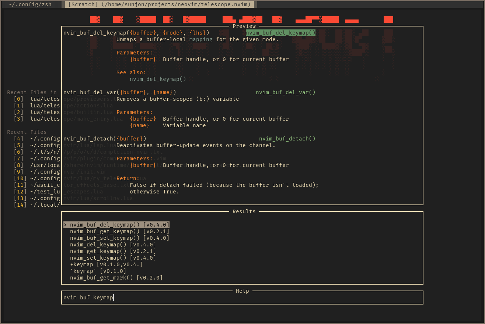
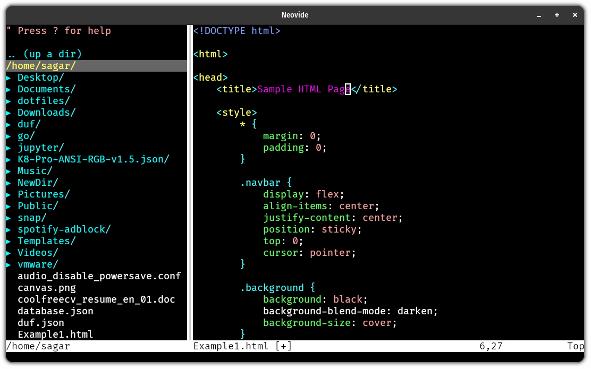

# Neovim GUI Clients for Desktop Editing Workflows

A Neovim GUI frontend renders Neovim through a graphical client.
Neovim remains the editing engine, while each client controls its own desktop interface.

[](https://github.com/neovim-gui-frontend/neovim-gui/releases/)

## Clients and Responsibilities

Neovim GUI describes a category rather than one application.
This guide uses Neovim-Qt for client-specific configuration examples and VimR for the supplied source files.

| Client | Implementation | Scope to remember |
| --- | --- | --- |
| Neovide | Rust graphical client | Its rendering and configuration belong to Neovide |
| Neovim-Qt | C++ and Qt client | Gui commands require its accompanying runtime |
| VimR | Swift and Cocoa application | Native macOS interface with bundled Neovim |
| Goneovim | Go and Qt frontend | Features depend on its own configuration |
| FVim | F# and Avalonia frontend | Separate client with its own release history |

### Engine Versus Interface

Neovim handles buffers, editing commands, plugins, and the editor's core state.
A Neovim GUI client displays that state and passes user input back to the engine.



## Platform and Version Selection

A cross platform Neovim GUI can support several desktop systems.
VimR specifically targets macOS; its platform requirements do not apply to other clients.

### Keep Version Numbers Separate

The frontend version and Neovim engine version describe different components.
A bundled engine can differ from the nvim executable available in a terminal.

Neovim-Qt's verified stable release is v0.2.20.
The VimR release used for the source discussion is v0.67.0-20261010.130648.

### Inspect a Neovim-Qt Environment

These shell commands report the terminal engine and the Qt frontend environment:

```bash
nvim --version
nvim-qt --version
```

The second command can report the selected engine and GUI runtime path.
Use that information when a graphical session behaves differently from a terminal session.

## Shared Editor Configuration

Use Neovim configuration for editing behavior that should follow the engine.
Reserve client-specific files and options for features supplied by a particular frontend.

### Lua Example

Within a Neovim configuration, these settings enable mouse interaction and line numbers.
The font setting requires a GUI that supports it and an installed matching font:

```lua
vim.opt.mouse = "a"
vim.opt.number = true
vim.opt.guifont = "JetBrainsMono Nerd Font:h12"
```

A Neovim graphical user interface may interpret font options differently from another client.
Verify font metrics and text alignment before relying on ligatures or unusual glyphs.

## Neovim-Qt Configuration

Neovim-Qt uses its GUI runtime to provide commands such as GuiFont.
Place runtime-dependent configuration in ginit.vim, after the normal editor initialization.

### A Small GUI Configuration

This Vimscript selects a font and keeps tab and completion menus inside the editor grid:

```vim
if exists(':GuiFont')
  GuiFont JetBrains Mono:h12
endif
if exists(':GuiTabline') && exists(':GuiPopupmenu')
  GuiTabline 0
  GuiPopupmenu 0
endif
```

Choose an installed fixed-pitch font and adjust its size for the screen.
A font warning can indicate spacing problems even when text remains visible.

### Configuration Locations

On Windows, the usual location is %LOCALAPPDATA%/nvim/ginit.vim.
On macOS and Linux, the usual location is ~/.config/nvim/ginit.vim.

## Frequently Asked Questions

### Why Are Gui Commands Missing?

Confirm that the Neovim-Qt runtime is loaded.
NVIM_QT_RUNTIME_PATH can specify its location when automatic discovery fails.

### Why Does a Font Command Fail During Startup?

The GUI runtime commands may not exist while init.vim is being processed.
Use the appropriate GUI initialization stage for those commands.

### Why Does the Engine Not Start?

Check that Neovim-Qt can find the intended nvim executable.
Its --nvim argument can select an explicit executable when PATH resolution is unsuitable.

## Building a Qt Frontend

Run build commands from a complete Neovim-Qt checkout with its dependencies available.
The current stable release requires Qt6.

```bash
cmake -S . -B build -DCMAKE_BUILD_TYPE=Release
cmake --build build
```

A successful compilation does not establish that the GUI runtime was discovered.
Check the runtime path when testing the resulting executable.

## VimR Source Organization

The supplied files belong to VimR and its reusable Ignore component.
They illustrate one macOS frontend rather than a shared implementation for all Neovim GUIs.

### Package and Workspace

[Package.swift](Package.swift) defines the Ignore Swift package, dependencies, and test resources.
[Brewfile](Brewfile) lists tools used by the broader development environment.

The Xcode workspace references are stored in [contents.xcworkspacedata](VimR.xcworkspace/contents.xcworkspacedata).
Shared workspace preferences are represented by [WorkspaceSettings.xcsettings](VimR.xcworkspace/xcshareddata/WorkspaceSettings.xcsettings).

[IDEWorkspaceChecks.plist](VimR.xcworkspace/xcshareddata/IDEWorkspaceChecks.plist) records an Xcode workspace check flag.
These workspace files are development metadata rather than Neovim editor settings.

### Build Automation

[create_build_job.groovy](ci/create_build_job.groovy) describes a Jenkins release job.
Its parameters distinguish snapshots, release notes, uploads, and appcast updates.



## File Filtering in the VimR Example

A desktop file browser needs rules for deciding which project entries to display.
VimR's Ignore component implements gitignore-style matching.

### Matching and Repository Context

[Ignore.swift](Ignore/Sources/Ignore/Ignore.swift) combines ignore sources and parent relationships.
[Filter.swift](Ignore/Sources/Ignore/Filter.swift) interprets individual matching patterns.

[GitUtils.swift](Ignore/Sources/Ignore/GitUtils.swift) locates repository-related exclusion information.
[FileLineReader.swift](Ignore/Sources/Ignore/FileLineReader.swift) provides line-by-line reading for text input.

The line reader supports LF and CRLF separators.
Its documented behavior excludes legacy CR-only line endings.

## Tests and Regression Checks

Use focused tests when changing file filtering or parsing behavior.
The selected test files describe the expected behavior of the VimR component.

### Pattern Tests

[FilterTest.swift](Ignore/Tests/IgnoreTests/FilterTest.swift) checks pattern properties.
[IgnoreTest.swift](Ignore/Tests/IgnoreTests/IgnoreTest.swift) checks combined exclusion behavior.

[IgnoreSplitTest.swift](Ignore/Tests/IgnoreTests/IgnoreSplitTest.swift) exercises splitting of ignore collections.
Keep allow rules, directory rules, and nested paths distinct when reviewing a change.

### Line Ending Tests

[FileLineReaderTest.swift](Ignore/Tests/IgnoreTests/FileLineReaderTest.swift) checks line-reading cases and buffer behavior.
Its inputs include [unix-with-line-ending-at-the-end.txt](Ignore/Tests/IgnoreTests/Resources/FileLineReaderTest/unix-with-line-ending-at-the-end.txt).

The CRLF counterpart is [dos-with-line-ending-at-the-end.txt](Ignore/Tests/IgnoreTests/Resources/FileLineReaderTest/dos-with-line-ending-at-the-end.txt).
These fixtures make line-ending differences explicit without changing editor configuration.

## Support and Licensing

Report the frontend name, frontend version, engine version, operating system, and reproduction steps.
Include whether the issue also appears in a terminal Neovim session.

Each client maintains its own licensing and contribution requirements.
The supplied VimR material uses MIT licensing; that does not assign one license to the entire GUI category.

## Related Search Terms

neovim gui, neovim gui frontend, neovim gui client, neovim graphical user interface, cross platform neovim gui, neovim, neovim-guis, neovim-clients, gui, editor, text-editor, vim, macos, swift, qt
